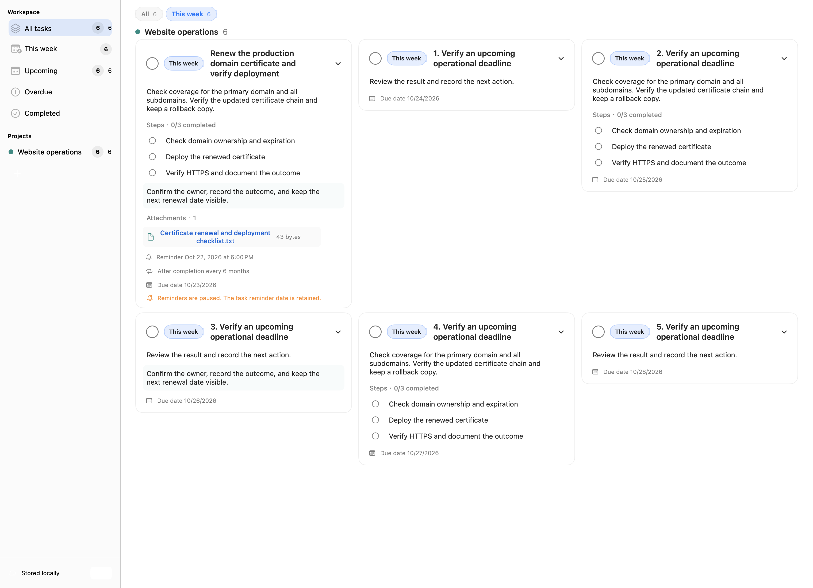

# WeekStride

**Plan your working week. Keep the details and the next action in view.**

WeekStride is a native macOS planner for individual project and operations work: the tasks you need to move forward this week, the dates you need to watch, and the recurring jobs you need to remember next time.

Its main focus is the working task list. You can review several projects, read the instructions and previous notes, work through steps, open the relevant files, and record completion from one screen. Organize that work by week, then add precise deadlines and reminders wherever they are needed.

Your work stays on your Mac. No account or cloud service is required, and automation is available through an optional local API that you enable and control.



*Three-column task view with rendered demo data. No real work data is shown.*

## Who it is for

WeekStride suits people who handle many small pieces of work across projects and need to keep the operational context close to each task.

| Working pattern | How WeekStride supports it |
|---|---|
| Website or service operations | Keep certificate renewals, maintenance checks, deployment notes, and checklists grouped by project |
| Office and project coordination | Review this week's commitments alongside task instructions, supporting files, and follow-up dates |
| Recurring administration | Record each completed occurrence and create the next task for periodic reviews or maintenance |
| Independent technical work | Move between a hands-on task list and trusted scripts or AI tools using the same local work data |

It is built around one person's work on one Mac. Shared assignment, team permissions, mobile clients, and cloud sync are outside the current feature set.

## What the design focuses on

### A working week you can actually use

Some work belongs in this week's plan before it has an exact deadline. Other work has a firm expiry date but can be handled on several different days. WeekStride records those decisions separately, so rescheduling your plan preserves the deadline and reminder.

The working week can start on any weekday. If your reporting cycle runs Thursday through Wednesday, weekly groups, counts, and completion history follow that cycle. Overdue planned work stays visible in the current week until you complete or reschedule it.

### Enough context to act on a task

A task card can show its instructions, execution steps, notes, attachments, and dates together. Details are editable in place. Full-detail and multi-column views support reviewing several tasks at once; titles-only mode provides a compact list with details available on expansion.

Projects give the work a home, while each project remembers its preferred view and week filter. A file dropped onto a task becomes a local attachment copy, keeping the material with the work across later reviews and recurring occurrences.

### Completion that leaves a useful record

Finishing a task records what was completed and when. A recurring task produces a new occurrence while retaining the finished record. You can review actual completions for a working week even when those tasks were originally planned earlier.

This supports two separate questions during a weekly review: what still needs attention, and what was actually finished? Changing a recorded completion date does not silently rewrite the dates of a later recurring task.

## Features

- **A week that fits your schedule.** Choose any day as the start of your working week, such as Thursday through Wednesday. Planning groups and completion history follow that setting.
- **Project tasks with inline details.** Read and edit task details, steps, notes, attachments, and dates directly on each card. Tasks can also exist without a project.
- **Separate planning, deadlines, and reminders.** Decide when to work on something, when it must be finished, and when to receive a notification independently.
- **A record of every completion.** Tasks and steps retain their completion dates. Completing a recurring task preserves the original and creates a separate next occurrence.
- **Flexible task views.** Use one, two, or three columns, or an adaptive layout. Show full details or expand tasks from a titles-only view. Each project remembers its view and week filter.
- **Local files and complete backups.** Drop files onto a task to copy them into local storage. Backups include projects, tasks, completion records, and referenced attachments.
- **An optional local API.** Let trusted scripts or AI tools manage projects, tasks, steps, plans, files, settings, and backups. Enable it yourself, authenticate with a token, and disable it or rotate the token at any time.

## Plan the week without losing the deadline

| Field | Purpose | Example |
|---|---|---|
| Planned date or week | When you intend to work on the task | Renew a certificate this week |
| Due date | When the work must be finished | The certificate expires at the end of the month |
| Reminder | When macOS should notify you | Three days before expiry, in the morning |
| Completion date | When the work was actually finished | Record Friday's deployment |

Unfinished tasks from earlier planned dates appear in the current week with an overdue planning indicator. Selecting the current week or a future week reschedules the task. A whole-week plan becomes overdue after that working week ends; a specific-date plan becomes overdue after that day. Changing the start of the week recalculates groups and counts while preserving the dates stored on each task.

Completed tasks remain available in history and below the pending tasks for their actual completion week. Completing some steps leaves the parent task open. Completing every step completes the parent; completing the parent also completes its remaining steps.

Recurrence can follow the actual completion date or a fixed due-date schedule, using days, weeks, months, years, or a custom interval. For example, completing a task set to repeat every six months creates its next occurrence immediately. The previous record remains intact. The next task inherits details, notes, and attachments, resets its steps, and starts without a weekly plan.

## Example: keeping a domain certificate up to date

An operations task can carry the plan, the deadline, the procedure, and the next follow-up together:

1. **Give it a project.** Create a Website operations project and add a task such as Renew the example.com certificate.
2. **Plan the work.** Select This week so it appears in the current working cycle. Set the due date to the certificate's actual recorded expiry and add a reminder a few days beforehand.
3. **Keep the procedure on the card.** Add details about the deployment, then steps such as verify domain ownership, renew and deploy the certificate, and check HTTPS after deployment.
4. **Keep supporting material nearby.** Attach the renewal checklist and add notes about the last deployment. The card displays these alongside the steps and dates.
5. **Record the outcome.** Check off the steps or complete the parent task. WeekStride records the actual completion dates and keeps the finished task available in history and its actual completion week.
6. **Create the next occurrence.** With recurrence set to every six months after completion, finishing the task creates the next one. The new task keeps the procedure, notes, and attachments, resets step completion, and starts without a weekly plan.

The next due date and reminder are calculated from the recurrence rule. Check them against the renewed certificate's actual validity and adjust them as needed; the application does not inspect the certificate. When the next review approaches, assign that occurrence to a working week without changing the finished record.

## Everyday workflow

1. Create a project, or add a task without a project from All tasks.
2. Use the top plus button or `Command-N` to add a task. Pick its planned week and enter a title, details, notes, and steps.
3. Press Return to save the task. Use `Shift-Return` for a new line in details or notes, or to continue with another step. Clicking outside the task keeps your input in place.
4. Drop files from Finder onto the card, or use the attachment button. WeekStride stores its own copy and leaves the original file untouched.
5. Add a due date, reminder, or recurrence when needed. Date and time shortcuts stay in the picker until you confirm.
6. Complete the work and review its history. Supported operations can be undone from the feedback bar or with `Command-Z`.

Drag a task to a sidebar project to move it, or to All tasks to remove its project assignment. Drop it onto a week tab to reschedule it. Moving a task or changing its plan preserves its text, other dates, steps, and attachments.

## Automation you choose to enable

The local API is intended to let a trusted tool work with the same projects and records you see in the app. For example, a script can query this week's tasks, an AI tool can add a follow-up with notes and steps, or an automation can complete a task after its work succeeds. The API also covers attachments, settings, managed backups, and confirmed backup restoration.

There is no built-in AI provider or AI subscription in WeekStride. You choose the tool, enable the API manually, and supply its access token. The server listens only on the local loopback address; you can stop it or rotate the token from the app. Initial activation and macOS permission decisions remain under your control.

The API can read attachment contents and change work data, so its token should be given only to trusted tools. A cloud AI tool may send that data to its own service. The [API guide](docs/API.md) documents the complete operations, confirmation requirements, and limits.

## Appearance and settings

Settings cover general preferences, appearance and motion, reminders, the local API, data and backups, and app information.

- Follow the system appearance or choose light or dark mode; select from four text sizes.
- Use English or Simplified Chinese, with system, 12-hour, or 24-hour time formatting.
- Choose your week start day, enable launch at login, and keep the app running in the menu bar.
- Set full details or titles-only mode, with fixed or adaptive columns. Narrow windows and larger text automatically reduce the column count.
- Choose a list transition effect or turn transitions off. The app respects the macOS Reduce Motion setting.

Reminders use macOS local notifications and require notification permission. Pausing reminders preserves the dates on your tasks, and reached reminders remain visible in the pending-reminders view. Notification delivery also depends on Focus and system settings.

## Data, privacy, and backups

WeekStride has no account, telemetry, built-in AI service, cloud sync, or third-party runtime dependencies. Task content and attachments are stored locally. You can open the data folder from Settings.

The legacy data identifier is retained for compatibility:

```text
~/Library/Application Support/local.workledger/
  data.json       # Projects, tasks, and completion records
  attachments/    # Local attachment copies
  api-token       # Local API access token
  Backups/        # Safety copies created before restoring a backup
  APIBackups/     # Managed snapshots created through the local API
```

A `.workledgerbackup` folder contains task data and referenced attachments, excluding the API token and application preferences. Restoring a backup replaces the current work data after creating a safety copy. Export a backup before uninstalling the app or moving to another Mac.

Data and backups are not additionally encrypted; they rely on your macOS account permissions and disk protection. Removing an attachment reference currently leaves the stored file in place to protect history and recurring tasks. Exported backups include only files still referenced by tasks.

The local API is off by default and listens only on `127.0.0.1:18743`. The app must be running; closing its window can leave it running in the menu bar, while quitting stops the API. It supports reading and changing work, uploading and downloading task attachments, managing backups, restoring work data, and changing application or project-view settings. It has no arbitrary filesystem access. API bootstrap and macOS notification permissions still require the app UI. See the [local API guide](docs/API.md) for discovery, examples, validation rules, and size limits.

Only share the API token with trusted tools: it permits changes to work data, attachment contents, settings, and backup restoration. WeekStride does not upload your work, but a cloud AI tool you authorize may send queried content to its own service.

## Install

Requires **macOS 14 or later**. Download the **Apple Silicon** archive from [GitHub Releases](https://github.com/zhutong1998/weekstride/releases/latest), extract it, and move `WeekStride.app` to Applications. The current download is ad-hoc signed and is not notarized by Apple. Intel source builds have not been tested on hardware.

Install the Apple Silicon build with Homebrew:

```bash
brew tap zhutong1998/weekstride https://github.com/zhutong1998/weekstride
brew install --cask zhutong1998/weekstride/weekstride
```

### Upgrading from WorkLedger

WeekStride retains the `local.workledger` bundle identifier and data directory, so existing tasks, attachments, preferences, and the API token remain available. The Homebrew cask name changes from `workledger` to `weekstride`. Export a backup, quit the old app, and replace it rather than running both app bundles at once. If removing a legacy cask, do not use `--zap`, which can remove application data and preferences.

## Build from source

Use **Xcode 26 or later with the macOS 26 SDK**. The resulting app still supports macOS 14 and later. A paid Apple Developer membership is not required to build and run it on your own Mac.

```bash
git clone https://github.com/zhutong1998/weekstride.git
cd weekstride
```

Open `WorkLedger.xcodeproj`, select **WorkLedger → My Mac**, and press `Command-R`. Internal project and module names remain `WorkLedger`; the application is named WeekStride.

Alternatively, run these commands from the repository root:

```bash
# Build the native application
./scripts/build.sh

# Run data-layer, local API, and other tests
swift test
```

The app is built at `build/Build/Products/Release/WeekStride.app`. The SwiftPM executable product, `WeekStrideDev`, is intended for development and testing. Use the bundled `.app` for everyday use so system notifications have the correct application identity.

The build script uses local ad-hoc signing. It does not perform Developer ID signing or Apple notarization.

## Contributing

Issues and improvements are welcome. For interface reports, include your macOS version, display settings, steps to reproduce, and expected behavior. Remove real task content, attachments, and access tokens before sharing screenshots or examples.

WeekStride uses Swift, SwiftUI, and macOS system frameworks, with no third-party libraries to install. It currently focuses on work on a single Mac; team collaboration, mobile apps, and cloud sync are not included.

## License

[MIT License](LICENSE).
